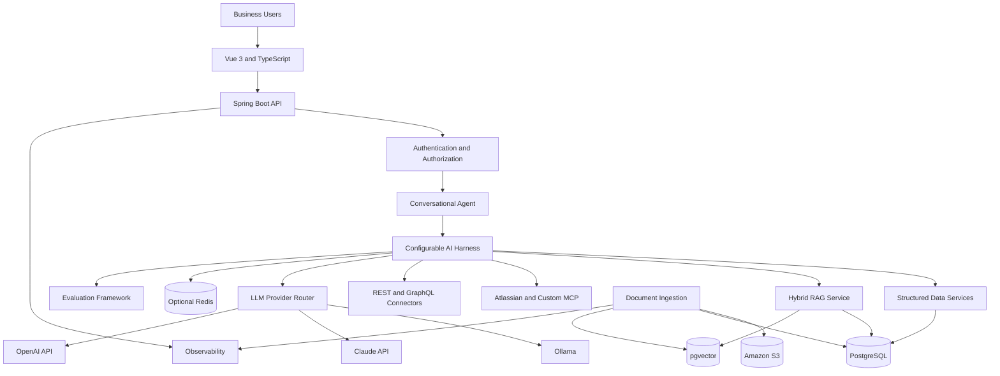
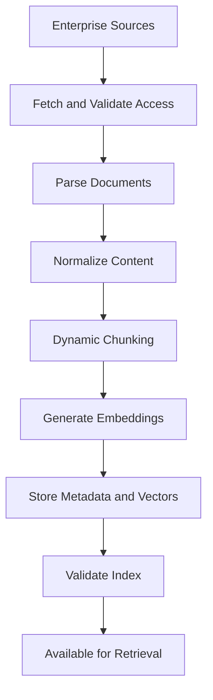
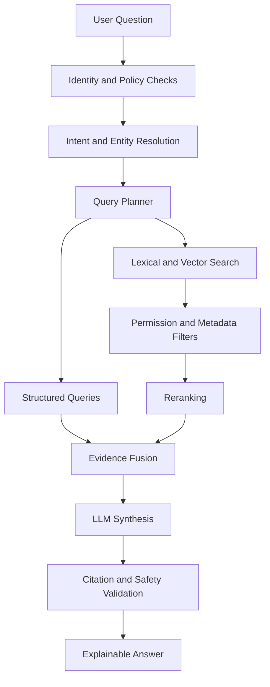
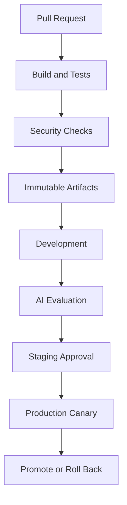

# Supplier Intelligence RAG Platform

<p align="center">


</p>

Enterprise Supplier Information Management, Sourcing, Risk, Performance, and Supply Chain Intelligence

An enterprise-grade Retrieval-Augmented Generation (RAG) platform combining structured supplier and ERP data with Confluence, Jira, Word, PDF, Excel, internal REST APIs, GraphQL APIs, and Model Context Protocol (MCP) tools to deliver a secure, explainable conversational AI experience.

## Table of Contents

- [Overview](#overview)
- [Business Capabilities](#business-capabilities)
- [Technology Stack](#technology-stack)
- [System Architecture](#system-architecture)
- [Repository Structure](#repository-structure)
- [Data Architecture](#data-architecture)
- [RAG Pipeline](#rag-pipeline)
- [AI Harness](#ai-harness)
- [Explainable AI](#explainable-ai)
- [Dynamic Chunking and Embeddings](#dynamic-chunking-and-embeddings)
- [LLM Providers](#llm-providers)
- [Fine-Tuning and MLOps](#fine-tuning-and-mlops)
- [Enterprise Integrations](#enterprise-integrations)
- [Security and Guardrails](#security-and-guardrails)
- [Caching and Performance](#caching-and-performance)
- [Evaluation Framework](#evaluation-framework)
- [Local Development](#local-development)
- [Testing](#testing)
- [Kubernetes Deployment](#kubernetes-deployment)
- [AWS Deployment](#aws-deployment)
- [CI/CD and Observability](#cicd-and-observability)
- [Implementation Roadmap](#implementation-roadmap)
- [Production Readiness Checklist](#production-readiness-checklist)
- [References](#references)

## Overview

The Supplier Intelligence RAG Platform enables procurement, sourcing, supplier management, risk, and supply chain teams to query enterprise information through a conversational interface.

The platform combines authoritative structured data with document retrieval and LLM-powered reasoning to produce evidence-backed answers.

### Example Questions

- Which suppliers have the highest risk, and what evidence supports the assessment?
- Compare supplier delivery, quality, and cost performance over the last four quarters.
- Identify alternative suppliers for a high-risk supplier.
- Explain why a supplier's risk rating has changed.
- Summarize supplier incidents from Jira and supporting policies from Confluence.
- Analyze supplier spend, purchase orders, invoices, and delivery delays.
- Identify single-source dependencies and supply chain vulnerabilities.
- Compare supplier qualifications, certifications, pricing, and performance.
- Explain the evidence behind a sourcing recommendation.

### Core Architectural Principles

- **Structured data first:** Supplier, sourcing, risk, performance, ERP, and supply chain facts come from PostgreSQL or approved business APIs.
- **RAG for enterprise knowledge:** Documents and knowledge sources provide supporting evidence and context.
- **Explainability by design:** Answers include citations, supporting records, data freshness, assumptions, and limitations.
- **Security by default:** Authorization is enforced before data reaches the LLM.
- **Provider independence:** LLM and embedding providers can be changed through configuration.
- **Evaluation-driven development:** Changes to retrieval, prompts, models, and harness behavior are measured against repeatable evaluations.
- **Bounded agent execution:** Tool calls, retries, iterations, latency, and token usage have explicit limits.

## Business Capabilities

| Domain | Capabilities | Primary Source |
|---|---|---|
| Supplier Information Management | Supplier profiles, locations, capabilities, certifications | PostgreSQL |
| Supplier Sourcing | Supplier qualification, bid comparison, sourcing recommendations | PostgreSQL and documents |
| Supplier Risk | Risk assessments, incidents, mitigation plans | PostgreSQL, Jira, and documents |
| Supplier Performance | Delivery, quality, service, and cost metrics | PostgreSQL |
| ERP Integration | Purchase orders, invoices, receipts, spend | ERP-integrated data |
| Supply Chain | Materials, facilities, lead times, dependencies | PostgreSQL and APIs |
| Enterprise Knowledge | Policies, contracts, specifications | Confluence, Word, PDF |
| Operational Intelligence | Incidents, issues, corrective actions | Jira |
| Spreadsheet Intelligence | Supplier scorecards and tabular reports | Excel |
| API Integration | Internal business operations | REST and GraphQL |
| Conversational AI | Multi-turn queries and synthesis | AI harness |
| Explainable AI | Citations, evidence, calculations, limitations | Evidence service |

## Technology Stack

| Layer | Technology |
|---|---|
| Backend | Java 21, Spring Boot |
| AI Framework | Spring AI or a provider-neutral orchestration layer |
| LLM Providers | Ollama, Anthropic Claude API, OpenAI API |
| Embeddings | Configurable local or hosted embedding models |
| Relational Database | PostgreSQL |
| Vector Database | pgvector |
| Frontend | Vue 3, TypeScript, Vite |
| Document Parsing | Apache Tika, Apache POI, PDFBox |
| Enterprise Integration | Atlassian MCP, custom MCP, REST, GraphQL |
| Caching | Caffeine, optional Redis |
| Security | Spring Security, OAuth 2.0/OIDC |
| Containerization | Docker |
| Orchestration | Kubernetes, Amazon EKS |
| Cloud Storage | Amazon S3 |
| Managed Database | Amazon RDS for PostgreSQL |
| Secrets | AWS Secrets Manager |
| Observability | Micrometer, OpenTelemetry, Prometheus, Grafana |
| Infrastructure as Code | Terraform |
| Testing | JUnit 5, Testcontainers, frontend test framework |

Select compatible, supported versions and pin dependencies and container images before deployment.

## System Architecture



### Architecture Layers

**Experience Layer**

- Conversational UI.
- Supplier comparison views.
- Inline citations and evidence panels.
- Conversation history and feedback.

**Application Layer**

- Spring Boot REST API.
- Authentication and authorization.
- Supplier domain services.
- Conversation and session management.

**Intelligence Layer**

- Intent classification and entity resolution.
- Query planning and routing.
- Structured query execution.
- Hybrid retrieval and reranking.
- Evidence fusion and response generation.
- Citation validation and guardrails.

**Data and Integration Layer**

- PostgreSQL and pgvector.
- Document ingestion and storage.
- Atlassian MCP.
- Custom MCP server.
- REST and GraphQL clients.

**Operations Layer**

- Evaluation datasets.
- Prompt and configuration versioning.
- Metrics, logs, and traces.
- Audit events and deployment controls.

## Repository Structure

```text
supplier-intelligence-rag/
├── README.md
├── pom.xml
├── .env.example
├── docker-compose.yml
├── Makefile
├── apps/
│   ├── supplier-ai-api/
│   ├── supplier-ai-ingestion/
│   ├── supplier-ai-evaluator/
│   └── supplier-ai-mcp/
├── frontend/
│   └── supplier-ai-ui/
├── libs/
│   ├── domain-model/
│   ├── data-access/
│   ├── rag-core/
│   ├── ai-harness/
│   ├── llm-providers/
│   ├── embedding-providers/
│   ├── retrieval/
│   ├── document-processing/
│   ├── enterprise-connectors/
│   ├── security-policy/
│   ├── evaluation/
│   └── observability/
├── config/
│   ├── harness/
│   ├── prompts/
│   ├── chunking/
│   └── guardrails/
├── database/
│   ├── migrations/
│   └── test-fixtures/
├── tests/
│   ├── unit/
│   ├── integration/
│   ├── retrieval/
│   ├── security/
│   └── evaluation/
└── deploy/
    ├── docker/
    ├── kubernetes/
    ├── helm/
    └── terraform/
```

This is the proposed target structure. Create the corresponding modules and configuration files before running the documented commands.

## Data Architecture

### PostgreSQL Schemas

| Schema | Responsibility |
|---|---|
| `supplier` | Supplier master and hierarchy |
| `sourcing` | Sourcing events, bids, qualification |
| `risk` | Risk assessments and mitigation |
| `performance` | Delivery, quality, and cost metrics |
| `erp` | Approved ERP extracts and views |
| `supply_chain` | Materials, facilities, dependencies |
| `knowledge` | Documents, chunks, embeddings |
| `ai` | Conversations and AI configuration |
| `audit` | Security and administrative events |

Integrate with existing authoritative schemas where possible. Avoid duplicating supplier master records unnecessarily.

### Example pgvector Migration

The following example uses 1,536-dimensional embeddings. Change the dimension to match the selected embedding model.

```sql
CREATE EXTENSION IF NOT EXISTS vector;

CREATE SCHEMA IF NOT EXISTS knowledge;

CREATE TABLE knowledge.document (
    document_id UUID PRIMARY KEY,
    source_system TEXT NOT NULL,
    source_document_id TEXT NOT NULL,
    title TEXT NOT NULL,
    source_uri TEXT,
    content_hash TEXT NOT NULL,
    tenant_id TEXT NOT NULL,
    classification TEXT NOT NULL DEFAULT 'INTERNAL',
    metadata JSONB NOT NULL DEFAULT '{}'::jsonb,
    indexed_at TIMESTAMPTZ,
    created_at TIMESTAMPTZ NOT NULL DEFAULT now(),
    UNIQUE (tenant_id, source_system, source_document_id)
);

CREATE TABLE knowledge.document_chunk (
    chunk_id UUID PRIMARY KEY,
    document_id UUID NOT NULL
        REFERENCES knowledge.document(document_id)
        ON DELETE CASCADE,
    chunk_index INTEGER NOT NULL,
    content TEXT NOT NULL,
    embedding VECTOR(1536),
    embedding_model TEXT NOT NULL,
    chunking_version TEXT NOT NULL,
    token_count INTEGER,
    page_number INTEGER,
    section_path TEXT,
    metadata JSONB NOT NULL DEFAULT '{}'::jsonb,
    created_at TIMESTAMPTZ NOT NULL DEFAULT now(),
    UNIQUE (document_id, chunk_index, chunking_version)
);

CREATE INDEX document_tenant_source_idx
    ON knowledge.document (tenant_id, source_system);

CREATE INDEX document_chunk_document_idx
    ON knowledge.document_chunk (document_id);

CREATE INDEX document_chunk_metadata_idx
    ON knowledge.document_chunk USING GIN (metadata);
```

Production deployments must add appropriate database roles, access policies, migrations, retention policies, and vector indexes based on measured workload.

### Data Governance

- Preserve source identifiers and source timestamps.
- Track document versions and content hashes.
- Enforce source access permissions during retrieval.
- Track ingestion status and indexing failures.
- Support document deletion and index invalidation.
- Define retention and audit requirements.
- Distinguish live structured data from indexed document snapshots.

## RAG Pipeline

### Document Ingestion



Ingestion responsibilities:

- Discover new and changed content.
- Fetch content using approved connector identities.
- Validate source permissions and classification.
- Parse Word, PDF, Excel, Confluence, and Jira content.
- Preserve document structure and source locations.
- Detect duplicate content using hashes.
- Apply the appropriate chunking profile.
- Generate embeddings.
- Store versioned chunks and metadata.
- Validate indexing before making the index available.

### Query-Time Retrieval



### Query Routing

| Question Type | Preferred Strategy |
|---|---|
| Supplier profile | Structured SQL or domain API |
| Spend aggregation | SQL or domain API |
| Contract interpretation | Document RAG |
| Jira incident summary | Authorized Jira/MCP retrieval |
| Qualified alternatives | Structured filtering plus document evidence |
| Risk explanation | Risk records plus supporting documents |
| Cross-source comparison | Parallel retrieval and evidence fusion |
| Insufficient evidence | Clarification or abstention |

Use hybrid retrieval combining vector similarity, lexical search, metadata filters, reranking, and source-aware evidence fusion.

Structured business calculations should be executed by deterministic services or approved SQL, not guessed by the LLM.

## AI Harness

The configurable AI harness manages orchestration, retrieval, tool execution, model routing, guardrails, and evaluation.

### Components

```text
AI Harness
├── RequestContextBuilder
├── IdentityAndPolicyResolver
├── IntentClassifier
├── EntityResolver
├── QueryPlanner
├── ModelRouter
├── StructuredDataExecutor
├── RetrievalExecutor
├── MCPToolExecutor
├── EvidenceAssembler
├── PromptComposer
├── ResponseGenerator
├── CitationValidator
├── GuardrailEngine
├── BoundedRetryController
├── CacheCoordinator
├── EvaluationHooks
└── TraceRecorder
```

### Example Harness Configuration

Create `config/harness/balanced.yml`:

```yaml
harness:
  profile: balanced
  version: "1.0"

  execution:
    max_iterations: 4
    max_tool_calls: 8
    request_timeout_ms: 30000
    max_total_tokens: 12000
    max_retries: 2

  routing:
    structured_data: domain_service
    document_retrieval: hybrid
    reranking: enabled
    multi_source_fusion: enabled

  retrieval:
    dense_top_k: 40
    lexical_top_k: 40
    rerank_top_k: 10
    final_context_top_k: 8

  chunking:
    strategy: structure_aware
    target_tokens: 700
    overlap_tokens: 100
    max_tokens: 1000

  caching:
    embedding_cache_enabled: true
    query_cache_enabled: true
    response_cache_enabled: false
    ttl_seconds: 300

  guardrails:
    enforce_document_acl: true
    enforce_tool_allowlist: true
    validate_citations: true
    detect_prompt_injection: true
    block_unauthorized_sql: true
    require_grounding: true

  evaluation:
    collect_trace: true
    enable_feedback: true
```

These are illustrative settings, not production performance guarantees.

Enforce security policies and hard resource limits in application code. User prompts must not be able to override them.

### Loop Engineering

Implement bounded reasoning and tool execution with:

- Maximum iteration and tool-call limits.
- Per-tool timeouts.
- Total request deadlines.
- Retry limits and exponential backoff.
- Duplicate-call detection.
- Tool output size limits.
- Explicit stop conditions.
- Structured failure and abstention responses.

Use tool results and validated evidence to drive subsequent steps. Do not allow uncontrolled agent loops.

## Explainable AI

Every answer should communicate:

- The conclusion.
- The source records and documents supporting it.
- Data freshness and timestamps.
- Calculations and assumptions.
- Uncertainty, conflicting evidence, and limitations.

### Example Evidence Metadata

```json
{
  "requestId": "req-example",
  "evidence": [
    {
      "evidenceId": "ev-001",
      "sourceType": "postgresql",
      "sourceRecord": "risk_assessment:example",
      "retrievalMethod": "structured_query",
      "sourceTimestamp": "2026-10-27T12:00:00Z"
    },
    {
      "evidenceId": "ev-002",
      "sourceType": "confluence",
      "sourceRecord": "document-reference",
      "retrievalMethod": "hybrid_search",
      "sourceTimestamp": "2026-10-25T09:00:00Z"
    }
  ],
  "limitations": [
    "Financial data freshness requires verification"
  ]
}
```

The identifiers are illustrative. Production answers must reference actual retrieved records.

The frontend should provide inline citations, authorized source links, expandable evidence, freshness indicators, and conflict warnings.

Explain conclusions using verifiable evidence and concise decision rationales. Do not expose private internal chain-of-thought.

## Dynamic Chunking and Embeddings

### Recommended Strategies

| Document Type | Strategy |
|---|---|
| Confluence | Heading and section aware |
| Jira | Issue fields and comments separated |
| Word | Heading, paragraph, and table aware |
| PDF | Page and section aware |
| Excel | Sheet, table, and row-group aware |
| Contracts | Clause and section aware |
| ERP records | Structured queries instead of indiscriminate text chunks |

### Example Chunking Profiles

```yaml
chunking_profiles:
  confluence:
    strategy: structure_aware
    target_tokens: 650
    overlap_tokens: 80
    preserve_headings: true

  jira:
    strategy: issue_aware
    target_tokens: 500
    overlap_tokens: 50
    separate_comments: true

  pdf:
    strategy: page_and_section_aware
    target_tokens: 800
    overlap_tokens: 100
    preserve_tables: true

  word:
    strategy: heading_aware
    target_tokens: 750
    overlap_tokens: 100
    preserve_tables: true

  excel:
    strategy: table_aware
    max_rows_per_chunk: 50
    repeat_column_headers: true
```

Version embedding models, dimensions, chunking profiles, and index configurations.

When changing embedding models, build a new index, evaluate retrieval quality, activate it only after validation, and retain a rollback path.

Do not mix incompatible embedding spaces in the same vector index without a validated migration strategy.

## LLM Providers

### Supported Providers

| Provider | Primary Use |
|---|---|
| Ollama | Local inference and development |
| Anthropic Claude API | Hosted generation and supported tool use |
| OpenAI API | Hosted generation and structured outputs |
| Embedding provider | Vector generation |
| Reranking provider | Candidate evidence ranking |

Model capabilities vary. Verify tool calling, context limits, licensing, regional processing, and data retention before deployment.

### Example Configuration

```yaml
llm:
  providers:
    ollama:
      enabled: true
      base_url: ${OLLAMA_BASE_URL:http://localhost:11434}
      model: ${OLLAMA_MODEL}

    anthropic:
      enabled: ${ANTHROPIC_ENABLED:false}
      api_key: ${ANTHROPIC_API_KEY:}
      model: ${ANTHROPIC_MODEL:}

    openai:
      enabled: ${OPENAI_ENABLED:false}
      api_key: ${OPENAI_API_KEY:}
      model: ${OPENAI_MODEL:}
```

Provider routing should consider task type, evaluated quality, latency, cost, context requirements, data classification, and provider availability.

Never expose API keys to frontend code.

## Fine-Tuning and MLOps

Fine-tuning is optional. First optimize retrieval, prompts, chunking, and evaluation.

### Recommended Progression

**Phase 1: RAG Optimization**

- Improve query routing and metadata filters.
- Tune chunking and prompts.
- Validate citation correctness.
- Build a golden evaluation dataset.

**Phase 2: Retrieval Optimization**

- Compare embedding models.
- Introduce reranking.
- Measure retrieval recall and relevance.

**Phase 3: Fine-Tuning**

- Consider classification, extraction, or response-format tasks where measured quality gaps remain.
- Evaluate on held-out data.
- Complete security and licensing reviews.
- Version and approve model releases.

Fine-tuning does not replace live supplier data retrieval or enforce authorization.

## Enterprise Integrations

### Integration Registry

```text
EnterpriseConnectorRegistry
├── PostgreSqlDomainConnector
├── AtlassianMcpConnector
├── CustomMcpConnector
├── RestApiConnector
├── GraphqlApiConnector
├── WordDocumentConnector
├── PdfDocumentConnector
└── ExcelDocumentConnector
```

### Atlassian MCP

Use an approved Atlassian MCP integration for Confluence and Jira.

Responsibilities:

- Authentication and authorization.
- Tool discovery.
- Search and retrieval.
- Pagination and rate limiting.
- Source links and version preservation.
- Permission-aware retrieval.
- Error normalization.
- Audit logging.

Start with read-only tools. Sensitive write operations require appropriate authorization and explicit confirmation.

### Custom MCP Server

Potential business tools:

```text
get_supplier_profile
search_suppliers
compare_supplier_performance
get_supplier_risk_assessment
get_supplier_risk_history
find_qualified_alternatives
get_supplier_spend_summary
get_supply_chain_dependencies
search_supplier_documents
```

Each tool requires a defined schema, authorization policy, timeout, output-size limit, error contract, and audit behavior.

MCP standardizes tool communication but does not replace backend authorization.

### REST and GraphQL

Implement typed clients with:

- Approved authentication.
- Explicit timeouts.
- Bounded retries and circuit breakers.
- Request correlation IDs.
- Pagination and response-size limits.
- Contract validation.
- Sensitive-field redaction.

Do not permit unrestricted LLM-generated SQL or GraphQL to execute against production systems.

## Security and Guardrails

### Essential Controls

| Area | Control |
|---|---|
| Authentication | Enterprise OIDC |
| Authorization | RBAC and attribute-based policies |
| Tenant isolation | Enforced in SQL and retrieval |
| Document permissions | Source ACL mapping |
| Database | Least-privilege roles and encrypted connections |
| Secrets | Secret manager and rotation |
| API protection | Rate limits and request deadlines |
| Tool execution | Allowlists and per-tool permissions |
| Audit | Security and administrative events |
| Logging | Redaction and retention limits |
| Software supply chain | Dependency and image scanning |

### Prompt-Injection Defense

Treat retrieved documents and tool outputs as untrusted input.

- Separate system instructions from retrieved evidence.
- Never let documents change system policies.
- Validate tool arguments outside the LLM.
- Enforce authorization in application services.
- Restrict outbound network access.
- Test adversarial documents.
- Require confirmation for sensitive writes.

A prompt is not a security boundary.

### Caching and Authorization

Cache keys must include relevant tenant, authorization, source-version, and configuration context. Invalidate results when permissions or underlying data change.

Authorization must be applied before evidence reaches the model.

## Caching and Performance

| Cache | Purpose |
|---|---|
| Embedding cache | Avoid re-embedding unchanged content |
| Retrieval cache | Reuse eligible search results |
| Structured query cache | Reduce repeated reads |
| Response cache | Reuse eligible complete answers |
| Metadata cache | Reduce source lookup overhead |

Start with embedding and metadata caching. Enable response caching only after authorization, freshness, and invalidation tests pass.

Monitor p50/p95 latency, SQL performance, vector search latency, cache hit rates, token usage, provider failures, and cost.

Never remove mandatory security checks to improve latency.

## Evaluation Framework

### Evaluation Metrics

| Category | Metrics |
|---|---|
| Retrieval | Recall@k, Precision@k, MRR, nDCG |
| Grounding | Supported-claim rate, citation correctness |
| Answer quality | Correctness, completeness, relevance |
| Abstention | Unsupported-answer rate |
| Security | ACL leakage, prompt-injection success, unauthorized tool calls |
| Performance | p50/p95 latency and timeout rate |
| Reliability | Error rate and fallback rate |
| Cost | Token usage and cost per successful answer |
| Operations | Index freshness and ingestion failures |

### Example Evaluation Case

```json
{
  "id": "supplier-risk-001",
  "question": "Why has supplier SUP-100 risk increased?",
  "expectedTools": [
    "get_supplier_risk_history",
    "compare_supplier_performance",
    "search_supplier_documents"
  ],
  "requiredEvidence": [
    "risk_history",
    "performance_records"
  ],
  "mustCiteSources": true,
  "allowAbstention": true
}
```

Build a golden dataset covering supplier profiles, risk, performance, sourcing, ERP, Confluence, Jira, Word, PDF, Excel, and cross-source questions.

Illustrative initial quality targets:

- Retrieval Recall@10: at least 0.90.
- Citation correctness: at least 0.98.
- Supported-claim rate: at least 0.95.
- Unauthorized cross-tenant retrieval: zero tolerated.
- Unauthorized tool execution: zero tolerated.

Calibrate quality thresholds against a labeled baseline. Security failures must remain hard release blockers.

## Local Development

### Prerequisites

Install:

- Java 21.
- Maven.
- Node.js LTS and npm.
- Docker and Docker Compose.
- Git.
- Ollama, if using local inference.

### Local Endpoints

| Service | Address |
|---|---|
| Vue frontend | http://localhost:5173 |
| Spring Boot API | http://localhost:8080 |
| PostgreSQL | localhost:5432 |
| Ollama | http://localhost:11434 |

### Environment Variables

Create `.env` from `.env.example`:

```dotenv
APP_ENV=local
APP_PORT=8080

DB_HOST=localhost
DB_PORT=5432
DB_NAME=supplier_ai
DB_USERNAME=supplier_ai_app
DB_PASSWORD=change-me-local-only

LLM_PROVIDER=ollama
OLLAMA_BASE_URL=http://localhost:11434
OLLAMA_MODEL=<supported-local-chat-model>

EMBEDDING_PROVIDER=ollama
EMBEDDING_MODEL=<supported-embedding-model>
VECTOR_DIMENSION=<embedding-dimension>

ANTHROPIC_API_KEY=
OPENAI_API_KEY=

ATLASSIAN_MCP_URL=
ATLASSIAN_TOKEN=

INTERNAL_API_BASE_URL=
GRAPHQL_API_URL=

REDIS_HOST=localhost
REDIS_PORT=6379

HARNESS_PROFILE=development
```

Replace placeholders with valid values. Ensure the embedding dimension matches the selected model.

Never commit `.env` or real credentials.

### Start PostgreSQL

Use a compatible pgvector image and pin an actual version before use.

Example `docker-compose.yml` service:

```yaml
services:
  postgres:
    image: pgvector/pgvector:<pinned-compatible-tag>
    environment:
      POSTGRES_DB: supplier_ai
      POSTGRES_USER: supplier_ai_app
      POSTGRES_PASSWORD: change-me-local-only
    ports:
      - "5432:5432"
    volumes:
      - supplier_pg_data:/var/lib/postgresql/data
    healthcheck:
      test: ["CMD-SHELL", "pg_isready -U supplier_ai_app -d supplier_ai"]
      interval: 5s
      timeout: 3s
      retries: 10

volumes:
  supplier_pg_data:
```

Replace the image placeholder before running.

Start PostgreSQL:

```bash
docker compose up -d postgres
docker compose ps
```

### Start Ollama

Install Ollama using its official instructions.

```bash
ollama pull <supported-local-chat-model>
ollama pull <supported-local-embedding-model>
ollama list
```

Select models compatible with your hardware and evaluate their quality.

### Build the Backend

After implementing the Maven modules:

```bash
mvn clean verify
mvn -pl apps/supplier-ai-api spring-boot:run
```

### Start the Frontend

```bash
cd frontend/supplier-ai-ui
npm ci
npm run dev
```

Open http://localhost:5173.

### Health Check

Assuming Spring Boot Actuator is configured:

```bash
curl http://localhost:8080/actuator/health
```

### Example Conversational Request

The following assumes the endpoint and request contract have been implemented:

```bash
curl -X POST http://localhost:8080/api/v1/chat \
  -H "Content-Type: application/json" \
  -H "Authorization: Bearer <local-test-token>" \
  -d '{
    "conversationId": null,
    "message": "Compare supplier performance for the last quarter"
  }'
```

Configure the appropriate local test identity and actual API contract.

## Testing

### Unit Tests

Test:

- Query classification and entity resolution.
- Chunking and metadata generation.
- Prompt assembly.
- Citation validation.
- Authorization policies.
- Harness configuration.
- Retry and loop limits.
- Cache invalidation.

### Integration Tests

Test:

- PostgreSQL migrations and pgvector.
- REST and GraphQL clients.
- MCP tool contracts.
- Word, PDF, and Excel parsing.
- Embeddings and vector search.
- Provider failures and timeouts.

### Security Tests

Verify that:

- Unauthorized documents never reach the model.
- Tenant isolation works across SQL, vectors, and caches.
- Prompt injection cannot authorize a tool call.
- Invalid tool arguments are rejected.
- Unrestricted SQL and GraphQL execution are blocked.
- Sensitive values are excluded from logs.
- Agent execution limits are enforced.

Use synthetic fixtures and mocked model responses for deterministic CI tests. Run real-model evaluations in a separate controlled pipeline.

## Kubernetes Deployment

### Recommended Workloads

| Workload | Resource |
|---|---|
| Spring Boot API | Deployment |
| Ingestion worker | Deployment |
| Evaluation runner | Job or CronJob |
| Database migration | Controlled Job |
| Frontend | Deployment or static hosting |
| Internal routing | Service |
| External routing | Ingress or cloud load balancer |
| Autoscaling | HorizontalPodAutoscaler |
| Availability protection | PodDisruptionBudget |

Use managed PostgreSQL in production unless there is a documented reason to operate it inside Kubernetes.

### Example API Deployment

Replace the image, identity, secret, and resource settings before deployment.

```yaml
apiVersion: apps/v1
kind: Deployment
metadata:
  name: supplier-ai-api
spec:
  replicas: 2
  selector:
    matchLabels:
      app: supplier-ai-api
  template:
    metadata:
      labels:
        app: supplier-ai-api
    spec:
      serviceAccountName: supplier-ai-api
      containers:
        - name: api
          image: <account>.dkr.ecr.<region>.amazonaws.com/supplier-ai-api:<immutable-tag>
          ports:
            - name: http
              containerPort: 8080
          env:
            - name: APP_ENV
              value: production
            - name: DB_HOST
              valueFrom:
                secretKeyRef:
                  name: supplier-ai-runtime
                  key: db-host
          readinessProbe:
            httpGet:
              path: /actuator/health/readiness
              port: http
            initialDelaySeconds: 20
            periodSeconds: 10
          livenessProbe:
            httpGet:
              path: /actuator/health/liveness
              port: http
            initialDelaySeconds: 30
            periodSeconds: 15
          resources:
            requests:
              cpu: "500m"
              memory: "1Gi"
            limits:
              cpu: "2"
              memory: "3Gi"
          securityContext:
            allowPrivilegeEscalation: false
            readOnlyRootFilesystem: true
            runAsNonRoot: true
```

This is an illustrative manifest. Configure the container's non-root user, writable volumes, complete environment variables, Service, network policies, scaling, and secret management.

### Production Controls

- Rolling deployments and readiness gates.
- Pod disruption budgets.
- Resource requests and limits.
- Graceful shutdown.
- Restricted network access.
- Workload identity and secret rotation.
- Immutable image tags.
- Image and dependency scanning.
- Controlled database migrations.
- Backup and recovery tests.

## AWS Deployment

### Reference Architecture

| AWS Service | Responsibility |
|---|---|
| Amazon EKS | API and worker workloads |
| Amazon ECR | Container images |
| Amazon RDS for PostgreSQL | Business data and pgvector |
| Amazon S3 | Document storage |
| AWS Secrets Manager | Credentials and API keys |
| AWS KMS | Encryption |
| Application Load Balancer | HTTPS ingress |
| AWS WAF | Web protection where required |
| IAM and workload identity | Least-privilege access |
| Amazon CloudWatch | Logs and metrics |
| Amazon ElastiCache for Redis | Optional distributed cache |
| AWS Backup | Backup management |
| Terraform | Infrastructure provisioning |

Verify pgvector support, PostgreSQL version compatibility, extensions, regional availability, and expected performance before provisioning RDS.

### Network Architecture

Use a VPC across multiple Availability Zones.

- Public subnets for the load balancer where required.
- Private subnets for EKS worker nodes.
- Private database subnets for RDS.
- Restricted egress for enterprise and model-provider APIs.
- Appropriate VPC endpoints.
- Explicit security groups and network policies.

Do not expose PostgreSQL or internal MCP endpoints publicly.

### Deployment Sequence

1. Provision the VPC and network boundaries.
2. Provision RDS PostgreSQL and validate pgvector.
3. Configure encryption, backups, and monitoring.
4. Provision EKS and workload identity.
5. Create ECR repositories and publish immutable images.
6. Configure Secrets Manager and IAM.
7. Deploy the API, workers, and frontend.
8. Run controlled database migrations.
9. Configure HTTPS ingress and WAF where appropriate.
10. Connect approved enterprise integrations.
11. Ingest a controlled document subset.
12. Run security, integration, and AI evaluations.
13. Validate monitoring, recovery, and rollback.
14. Gradually enable production users.

### Terraform Structure

```text
deploy/terraform/
├── modules/
│   ├── network/
│   ├── eks/
│   ├── rds-postgresql/
│   ├── s3-documents/
│   ├── secrets/
│   ├── observability/
│   └── ingress/
└── environments/
    ├── dev/
    ├── staging/
    └── prod/
```

Protect Terraform state, review infrastructure plans, restrict access, and avoid committing state files or sensitive values.

### Recovery Planning

Define and test:

- Recovery Point Objective (RPO).
- Recovery Time Objective (RTO).
- Database retention and point-in-time recovery.
- Document-store recovery.
- Vector index rebuild time.
- Model-provider outage behavior.
- Source connector outage behavior.

Preserve prompts, model configuration, index versions, evaluation datasets, and connector settings alongside database backups.

## CI/CD and Observability

### CI Pipeline

For every pull request:

- Compile Java modules.
- Run unit and integration tests.
- Validate frontend types and lint rules.
- Test database migrations.
- Run dependency and static analysis scans.
- Validate configuration schemas.
- Run retrieval and answer regression tests.
- Build and scan container images.
- Publish test and evaluation reports.

### CD Pipeline



### Observability

Capture:

- Request volume and errors.
- End-to-end latency.
- SQL and vector search latency.
- Model-provider latency and failures.
- Token usage and estimated cost.
- Cache hit rates.
- Ingestion lag and failed documents.
- Index freshness.
- Citation-validation failures.
- Guardrail blocks.
- Tool-call failures.
- Evaluation regressions.

Use correlation IDs across API calls, retrieval, MCP operations, model requests, and validation stages.

Avoid logging confidential documents, credentials, or unnecessary personal data.

## Implementation Roadmap

### Phase 1: Foundation

- Spring Boot API and Vue frontend.
- Authentication and authorization.
- PostgreSQL schemas and migrations.
- Supplier domain services.
- Synthetic test data and CI.

**Exit criterion:** Supplier facts can be retrieved and verified without an LLM.

### Phase 2: Core RAG

- Document ingestion.
- Word, PDF, and Excel parsers.
- pgvector and embeddings.
- Dynamic chunking.
- Hybrid retrieval.
- Citations and answer synthesis.

**Exit criterion:** Document questions produce grounded, cited answers.

### Phase 3: Enterprise Integrations

- Atlassian MCP.
- Custom MCP server.
- REST and GraphQL connectors.
- Incremental synchronization.
- Permission mapping and audit events.

**Exit criterion:** Authorized users can retrieve evidence from approved enterprise sources.

### Phase 4: AI Harness

- Model routing.
- Query planning.
- Bounded tool execution.
- Configurable retrieval.
- Guardrails, retries, deadlines, and caching.

**Exit criterion:** Harness behavior is configurable, measurable, and reversible.

### Phase 5: Explainability and Evaluation

- Evidence ledger.
- Citation validation.
- Golden datasets.
- Security tests.
- Retrieval and answer metrics.
- Regression gates.

**Exit criterion:** AI behavior can be evaluated and audited.

### Phase 6: Advanced ML

- Embedding comparisons.
- Reranking.
- Chunking experiments.
- Optional fine-tuning.
- Controlled model promotion.

**Exit criterion:** Changes demonstrate measurable improvements.

### Phase 7: Production Deployment

- AWS EKS and managed PostgreSQL.
- S3, secrets, monitoring, and backups.
- Infrastructure as code.
- CI/CD and release controls.
- Load, security, and disaster recovery tests.

**Exit criterion:** The platform meets approved security, quality, performance, and operational requirements.

## Production Readiness Checklist

### Data and Integrations

- [ ] Structured queries use authoritative sources.
- [ ] Business calculations match verified expected results.
- [ ] Data freshness is visible.
- [ ] Conflicting data is handled explicitly.
- [ ] Document parsers and connectors are tested.
- [ ] Ingestion is idempotent and version-aware.

### AI and RAG

- [ ] Hybrid retrieval has been evaluated.
- [ ] Chunking and embeddings are versioned.
- [ ] Model routing is tested.
- [ ] Tool calls and agent loops are bounded.
- [ ] Citations are validated.
- [ ] Unsupported questions trigger clarification or abstention.
- [ ] Evaluation results are reproducible.

### Security

- [ ] Authentication and authorization are enforced.
- [ ] Tenant isolation has passed adversarial tests.
- [ ] Document permissions are enforced before model access.
- [ ] Unrestricted SQL and GraphQL execution are blocked.
- [ ] Secrets are not committed.
- [ ] Prompt injection cannot grant privileges.
- [ ] Sensitive actions require appropriate approval.
- [ ] Logging and retention policies are reviewed.

### Operations

- [ ] Database migration and rollback plans exist.
- [ ] Dashboards and alerts are configured.
- [ ] Backup restoration has been tested.
- [ ] Model-provider outage behavior is validated.
- [ ] Images are scanned and pinned.
- [ ] AI configuration and model versions are traceable.
- [ ] Recovery objectives are documented.

## References

### Core Technologies

- [Java](https://dev.java/)
- [Spring Boot](https://spring.io/projects/spring-boot)
- [Spring AI](https://spring.io/projects/spring-ai)
- [PostgreSQL](https://www.postgresql.org/docs/)
- [pgvector](https://github.com/pgvector/pgvector)
- [Vue.js](https://vuejs.org/)
- [TypeScript](https://www.typescriptlang.org/docs/)
- [Apache Tika](https://tika.apache.org/)
- [Apache POI](https://poi.apache.org/)

### AI and Integrations

- [Ollama](https://ollama.com/)
- [OpenAI API](https://platform.openai.com/docs/)
- [Anthropic API](https://docs.anthropic.com/)
- [Model Context Protocol](https://modelcontextprotocol.io/)
- [Atlassian Developer Documentation](https://developer.atlassian.com/)

### Deployment and Operations

- [Docker](https://docs.docker.com/)
- [Kubernetes](https://kubernetes.io/docs/)
- [Amazon EKS](https://docs.aws.amazon.com/eks/)
- [Amazon RDS for PostgreSQL](https://docs.aws.amazon.com/AmazonRDS/latest/UserGuide/CHAP_PostgreSQL.html)
- [Amazon S3](https://docs.aws.amazon.com/s3/)
- [Terraform](https://developer.hashicorp.com/terraform/docs)
- [OpenTelemetry](https://opentelemetry.io/docs/)

## Final Architectural Recommendation

Start with a modular Spring Boot application, PostgreSQL with pgvector, a provider-neutral AI harness, and a Vue.js conversational interface.

Prioritize authoritative supplier data access, permission-aware retrieval, citations, explainability, and evaluation before introducing complex autonomous agent workflows.

Keep fine-tuning, advanced reranking, dynamic chunking experiments, and additional model providers configurable and independently testable.

> **Implementation note:** This README describes the proposed target architecture. The repository must contain the corresponding application code, configuration, tests, and deployment manifests before the documented commands can be considered executable.
